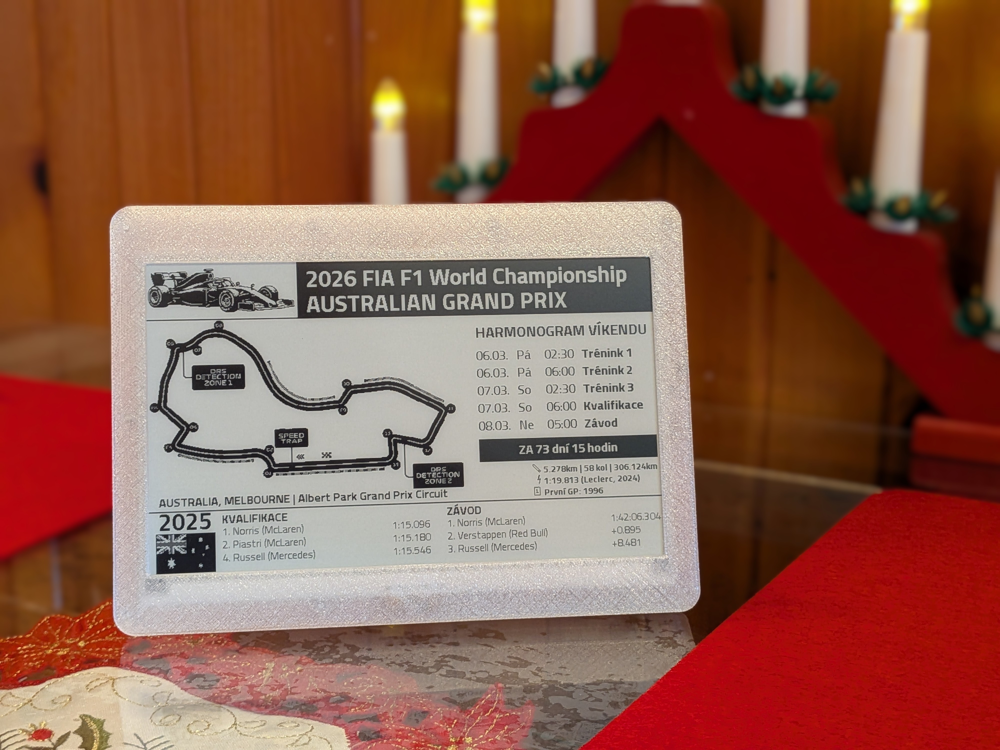
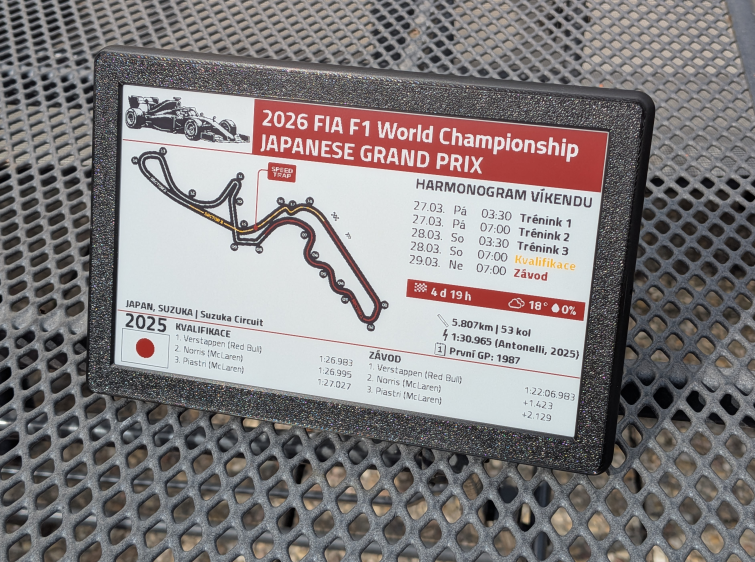

# F1 E-Ink Calendar

Independent, noncommercial fan project for e-paper race calendars. Not affiliated with,
endorsed by or sponsored by the Formula One group, FIA, teams or drivers.

The project retains its F1.InkyCloud.click name and original car illustration, which
the maintainer identifies as AI-generated. Team logos have been removed; teams are
shown by name (with a colour swatch on the configure page), as recorded in [the asset notices](DATA_LICENSES.md).
Configure your actual `SITE_URL`; the examples use a reserved example domain.

[](./SELF-HOSTING.md)
[](https://codspeed.io/Rhiz3K/InkyCloud-F1?utm_source=badge)

---

## Preview



_LaskaKit 7.5" E-Ink display showing F1 race calendar in Czech_



_SVERIO PaperBoard 7.5" GDEM075F52 four-color 800×480 ePaper (black/white/yellow/red)_

---

## Quick Start — Use It Now!

Configure your deployed instance following [the self-hosting guide](SELF-HOSTING.md):

### For [zivyobraz.eu](https://zivyobraz.eu) Users

1. Register at [zivyobraz.eu](https://zivyobraz.eu) and add your ePaper device
2. In device settings, select **"URL"** as content source
3. Enter the calendar URL:
   ```
   https://racing.example.com/calendar.bmp?lang=cs
   ```
4. Done! Your E-Ink display will show the next F1 race 🏁

Živýobraz.eu allows one URL per display. To get both screens on that one URL, use
`/auto.bmp`: it shows the calendar during the race week and the teams with a countdown
otherwise (see [One URL for Both Screens](docs/parameters.md#one-url-for-both-screens-autobmp)):

```
https://racing.example.com/auto.bmp?lang=cs&tz=Europe/Prague
```

The configure page (`/configure/calendar`, `/configure/teams`) builds the URL for you with a
live preview. Writing your own firmware? See [Firmware integration](docs/firmware.md).

### URL parameters at a glance

| Parameter | Values | Purpose |
| --------- | ------ | ------- |
| `lang` | `cs`, `de`, `en`, `es`, `fr`, `it`, `ja`, `nl`, `pl`, `pt-BR`, `sk`, `tr`, `zh-CN` | Image language |
| `tz` | Any IANA timezone | Race times in your timezone |
| `display` | `1bit`, `bwr`, `bwry`, `spectra6` | Panel palette |
| `weather`, `weather_type` | `true`/`false`; `race_day`, `race`, `current`, `weekend`, `off` | Weather on the calendar |
| `temp_unit` | `c` (default), `f` | Celsius or Fahrenheit |
| `countdown` | `hours` (default), `days`, `auto`, `off` | How often the countdown changes |
| `weekend_mode` | `off` (default), `auto` | Follow the race weekend session by session |
| `year`, `round`, `race_key` | Season and race | Show a specific race |
| `track_style`, `track_source`, `track_accent` | See `/api/tracks` | Circuit artwork |
| `format`, `rotate` | `bmp`/`png`; `0`/`180` | Palette-exact PNG, upside-down panel |
| `theme` | `light` (default), `dark` | Experimental dark theme |

Every parameter with examples and details: **[URL parameters](docs/parameters.md)**.

---

## Features

- **800x480 BMP output** — `1bit` monochrome, `bwr` B/W/R, `bwry` B/W/R/Y, and `spectra6` 6-color mode for both calendar and teams screens
- **Teams & Drivers screen** — Dedicated `teams.bmp` render for the default or selected season with constructor lineup, plain driver numbers, and championship points
- **Localized UI and assets** — Routing, configure pages, previews, docs, and pregenerated BMPs support `cs`, `de`, `en`, `es`, `fr`, `it`, `ja`, `nl`, `pl`, `pt-BR`, `sk`, `tr`, and `zh-CN`
- **Hourly regeneration + startup warmup** — Calendar and teams assets are regenerated on startup and every hour, with version metadata refreshed hourly and teams render assets warmed on boot
- **Any Timezone** — Convert race times to your local timezone
- **Race Status States** — Upcoming countdown, `IN PROGRESS` / `PROBÍHÁ`, `COMPLETED` / `DOKONČEN`, and cancelled race handling
- **Optional Weather Overlay** — Current, race-day forecast, and historical race-time weather on the calendar screen
- **Historical Results** — Previous year's podium for each circuit
- **Track Info** — Licensed circuit map plus circuit length and lap record (Wikipedia, CC BY-SA 4.0) and first Grand Prix and planned lap count (Jolpica, CC BY-NC-SA 4.0) where available; the two datasets are stored separately and combined only when rendering
- **Circuit artwork** — 18 styles, all 16 accent combinations and reviewed Jules Roy / Wikimedia Commons outlines for all 26 circuits in all four display palettes, without F1 raster fallbacks; defaults are isometric relief, all four accents and Jules Roy ([artwork API and licences](TRACK_ARTWORK.md))
- **Image output options** — race weekend mode, weekend weather, Fahrenheit, palette-exact PNG, 180° rotation and an experimental dark theme
- **One URL for both screens** — `/auto.bmp` switches between calendar and teams for displays that poll a single address
- **Battery-friendly polling** — `ETag`/`304` revalidation and an `X-Next-Refresh-Seconds` deep-sleep hint
- **Interactive configure flow** — Localized `/configure/calendar` and `/configure/teams` pages with pregenerated previews, direct BMP URLs, weather/display switching, and season leaders sidebar
- **SEO-friendly public pages** — Canonical URLs, hreflang alternates, `robots.txt`, and a localized `sitemap.xml` without synthetic daily `lastmod` churn
- **Session Schedule** — FP1, FP2, FP3, Qualifying, Sprint, Race times

### Roadmap

- [ ] **Custom layouts** — Multiple layout options to choose from
- [ ] **Additional display sizes** — Beyond 800x480 (e.g. 4.2", 5.83", 12.48")
- [ ] **More languages** — Additional community/localized translations beyond the current 13 supported locales

Delivered features and their versions are listed in the [changelog](CHANGELOG.md).

---

## Documentation

| Document | Contents |
| -------- | -------- |
| [URL parameters](docs/parameters.md) | Every image parameter, race weekend mode, weather, PNG and rotation, dark theme, `/auto.bmp` |
| [Firmware integration](docs/firmware.md) | Živýobraz.eu, ESP32 example, `ETag`/`304`, `X-Cache`, `X-Next-Refresh-Seconds`, countdown modes |
| [API](docs/api.md) | Public routes and JSON API endpoints, statistics access |
| [EXAMPLES.md](EXAMPLES.md) | Ready-to-run `curl` commands and a Python client |
| [SELF-HOSTING.md](SELF-HOSTING.md) | Docker, configuration, runtime behaviour, operations, backups, development |
| [TRACK_ARTWORK.md](TRACK_ARTWORK.md) | Circuit artwork styles, sources and licences |
| [Data collection](docs/data-collection.md) | Statistics, retention, privacy and the runtime check |
| [CHANGELOG.md](CHANGELOG.md) | Release history |

---

## Self-Hosting

Production, CI, and local development use **Python 3.15**. Released containers are published to
GHCR with immutable version and commit tags, an SBOM, and provenance.

### Quick Docker Start

```bash
git clone https://github.com/Rhiz3K/InkyCloud-F1.git
cd InkyCloud-F1
cp .env.example .env
F1_IMAGE=ghcr.io/rhiz3k/inkycloud-f1:vX.Y.Z docker compose pull
F1_IMAGE=ghcr.io/rhiz3k/inkycloud-f1:vX.Y.Z docker compose up -d --no-build
```

### Deployment Guides

- **[DEPLOYMENT.md](./DEPLOYMENT.md)** — choose the correct deployment path
- **[SELF-HOSTING.md](./SELF-HOSTING.md)** — Docker, operations, backups, and development
- **[COOLIFY.md](./COOLIFY.md)** — Coolify Dockerfile build from `main`, releases and rollback
- **[.env.example](./.env.example)** — canonical environment-variable reference
- **[scripts/README.md](./scripts/README.md)** — maintenance and unified asset CLI
- **[BMP_PROCESSING.md](./BMP_PROCESSING.md)** — source-art and runtime BMP pipeline

---

## License

See [LICENSE](LICENSE) file for details.

## Contributing

Contributions are welcome! See [CONTRIBUTING.md](./CONTRIBUTING.md) for guidelines.

## Credits

- **Inspiration:** [FoxeeLab's original F1 E-Ink project](https://x.com/foxeelab/status/1761498129268981856)
- **Race data:** [Jolpica-F1 API](https://github.com/jolpica/jolpica-f1)
- **Weather:** [Open-Meteo](https://open-meteo.com)
- **Icons:** [Weather Icons](https://github.com/erikflowers/weather-icons) by Erik Flowers (SIL OFL 1.1)
- **Flags:** [Flagcdn](https://flagcdn.com)
- **Platform:** [Živýobraz.eu](https://zivyobraz.eu)
- **Devices:** [LaskaKit](https://www.laskakit.cz/) and [SVERIO](https://pajenicko.cz/sverio-paperboard-ctyrbarevny-7.5-gdem075f52-s-cernym-rameckem)
- **Hosting:** [Coolify](https://coolify.io) + [Hetzner](https://www.hetzner.com/)

## Rights and privacy

The MIT licence covers the source code only; it does not relicense data, map artwork, fonts
or dependencies.
Read [data licences](DATA_LICENSES.md), [third-party notices](THIRD_PARTY_NOTICES.md)
and [data collection](docs/data-collection.md). There is no third-party analytics.
The default profile retains aggregate operational statistics.
Commercial deployments must independently resolve the noncommercial data conditions.
Vendored files in `app/assets/vendor/` are not under the project MIT licence; see
[third-party notices](THIRD_PARTY_NOTICES.md).
